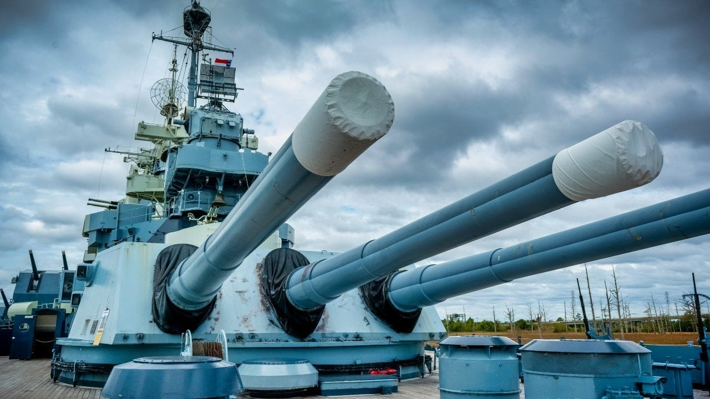

# Hundir la Flota 

Juego de Hundir la Flota (Battleship) en Python, jugando contra la máquina.
Proyecto individual del curso.

## Cómo jugar

1. Se crean dos tableros de 10x10: el tuyo y el de la máquina.
2. Los barcos se colocan de forma aleatoria en los dos tableros.
3. En tu turno, escribe la fila y la columna (de 0 a 9) donde quieres disparar.
4. Después dispara la máquina, de forma aleatoria, a tu tablero.
5. Gana quien hunda primero todos los barcos del rival.

## Símbolos del tablero

| Símbolo | Significado |
|---------|-------------|
| `_`     | sin disparar |
| `O`     | Barco |
| `X`     | Tocado |
| `A`     | Agua (disparo fallado) |

## Funciones que incluye el juego

- `crear_tablero(tamaño)`: crea un tablero vacío con numpy.
- `mostrar_tablero(tablero, titulo)`: muestra el tablero con números de filas y columnas.
- `colocar_barco(barco, tablero)`: coloca un barco a partir de su lista de casillas.
- `disparar(casilla, tablero)`: dispara a una casilla y marca X (tocado) o A (agua).
- `crear_barco(eslora)`: crea un barco aleatorio que no se sale del tablero.
- `colocar_barcos(tablero)`: coloca toda la flota sin que los barcos se superpongan.

## Autora

Maxima Milano
